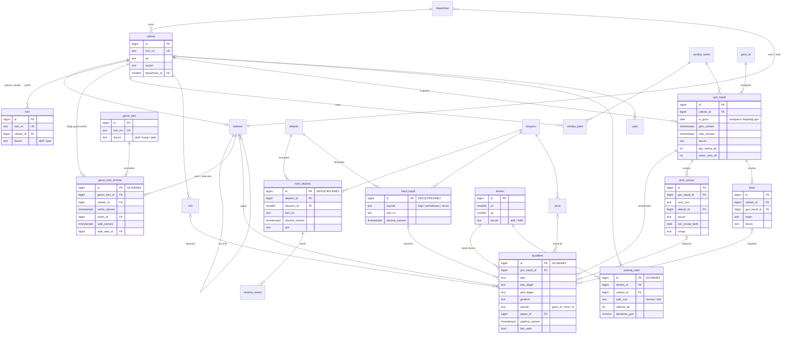

# Veritabanı Tasarımı (Supabase / PostgreSQL)

Veritabanı **Supabase** (bulutta PostgreSQL). Tüm tablolar `pdks` adlı şemada durur.
İş kuralları (gece işi, düzeltme, görevler ayrılığı, ay kilidi) PostgreSQL fonksiyonları ve trigger'lar
olarak veritabanının içinde çalışır.

## Erişim modeli

- **Giriş:** Supabase Auth. Her kullanıcının `pdks.kullanici` satırı `auth_kullanici_id` sütunuyla
  Supabase Auth kullanıcısına, `calisan_id` sütunuyla kendi çalışan kaydına bağlanır. Rol `kullanici.rol`
  sütunundadır: `amir`, `ik`, `guvenlik`, `yonetici`. Oturumdaki kullanıcıyı `pdks.oturum_kullanici_id()`,
  rolünü `pdks.oturum_rolu()` verir.
- **Yetki:** Her tabloda RLS (satır düzeyinde güvenlik) açıktır. Politikalar oturumdaki kullanıcının rolüne
  bakar. Örneğin amir yalnızca kendi departmanının sorularını görür, güvenlik yalnızca geçici kart ekranını kullanır.
- **Veri bağlantısı:** Next.js uygulaması supabase-js ile bağlanır. Okuma sorgu oluşturucusuyla, kural içeren
  her yazma işlemi veritabanı fonksiyonu üzerinden RPC ile yapılır (ör. `pdks.duzeltme_uygula`).
- **Gece işi:** pg_cron her gece veritabanı içinde çalıştırır; demoda ekrandaki buton aynı fonksiyonu RPC ile tetikler.

> **RLS** = "bu kullanıcı bu satırı görebilir mi?" sorusunu her sorguda veritabanının kendisinin sorması.
> **RPC** = uygulamanın, veritabanındaki bir fonksiyonu adıyla çağırması.

## Dosyalar

| Dosya | İçerik |
|---|---|
| `supabase/migrations/20261114000100_tablolar.sql` | Şema ve 24 tablo |
| `supabase/migrations/20261114000200_kurallar.sql` | Trigger'lar, fonksiyonlar, görünümler (silinemezlik, ay kilidi) |
| `supabase/migrations/20261114000300_roller_ve_yetkiler.sql` | `pdks_uygulama` ve `pdks_gece_isi` rolleri, yetkiler |
| `supabase/migrations/20261114000400_varsayilan_ayarlar.sql` | İK ayarlarının varsayılanları, örnek vardiyalar |
| `supabase/migrations/20261115000500_fazla_mesai.sql` | Fazla mesai: yazılı onay, plan, 270 saat / 11 saat sınırları (+2 tablo) |
| `supabase/migrations/20261117010000_kiosk_kaldir.sql` | Şema düzenlemesi: PIN alanları ve ilgili fonksiyonlar |
| `supabase/migrations/20261117020000_gecici_kart.sql` | Geçici kart ve zimmet, `guvenlik` rolü, geçici kart uyarıları, `okutma_sahibi()` |
| `supabase/migrations/20261117030000_kart_paylasimi.sql` | Kart paylaşımı şüphe kuralı (`kart_paylasim_kontrol()`) |
| `supabase/migrations/20261118010000_sema_temizligi.sql` | Tablo açıklamaları ve ayar geçmişi düzenlemesi |
| `supabase/migrations/20261118020000_gorevler_ayriligi.sql` | `kullanici.calisan_id`, "kimse kendi kaydında işlem yapamaz" trigger'ları |
| `supabase/migrations/20261118030000_giris_ve_yetki.sql` | Oturum fonksiyonları, `authenticated` okuma yetkisi, RLS politikaları, görünüm ayarları |
| `supabase/migrations/20261118040000_ayar_al_yetkisi.sql` | `ayar_al()` sahibinin yetkisiyle çalışır, `authenticated` çalıştırabilir (`v_fazla_mesai_yillik` düzeltmesi) |
| `supabase/migrations/20261119010000_ekran_fonksiyonlari.sql` | Ekranların çağırdığı 22 RPC fonksiyonu; ayrıntı: [ekran_fonksiyonlari.md](ekran_fonksiyonlari.md) |
| `supabase/migrations/20261119010000_ekran_fonksiyonlari.sql` | Ekranların yazma işlemleri için RPC fonksiyonları (ayrıntı: `docs/ekran_fonksiyonlari.md`) |
| `supabase/migrations/20261120010000_gece_isi.sql` | Gece işi (`gece_isi_calistir`), demo düğmesi (`gece_isi_tetikle`), pg_cron zamanlaması; üst amiri olmayan amirin kendi sorusu İK'ya gider |
| `supabase/tests/kurallar_testi.sql` | 27 kural testi (her şeyi geri alır, iz bırakmaz) |
| `supabase/tests/gece_isi_testi.sql` | Gece işi: 23 mekanik test (her zaman) + örnek veri yüklüyse S1–S23 senaryoları (26 test) |
| `supabase/tests/fazla_mesai_testi.sql` | Fazla mesai kural testleri |
| `supabase/tests/gecici_kart_ve_paylasim_testi.sql` | Geçici kart, kart paylaşımı ve fonksiyon yetkileri için 35 test |
| `supabase/tests/gorevler_ayriligi_testi.sql` | Görevler ayrılığı için 20 test |
| `supabase/tests/giris_ve_yetki_testi.sql` | Rol bazında görünürlük (RLS) ve görünüm fonksiyonu yetkileri için 29 test |
| `supabase/tests/ekran_fonksiyonlari_testi.sql` | Ekran fonksiyonlarının rol, departman ve görevler ayrılığı kontrolleri için 42 test |
| `supabase/seed.sql` | Örnek (sahte) veri: Kasım 2026, 31 çalışan, 23 senaryo. Ayrıntı: `docs/ornek_veri.md` |
| `supabase/tests/ornek_veri_testi.sql` | Örnek verinin büyüklüğü ve senaryoları için 37 test (seed'den sonra çalışır) |
| `supabase/tests/sema_temizligi_testi.sql` | Şemada kullanılmayan özelliklere ait kalıntı olmadığını doğrulayan 8 test |

> **Migration** = veritabanını adım adım kuran, sırayla çalıştırılan SQL dosyası.
> **Trigger** = bir tabloya ekleme/değiştirme/silme yapılırken kendiliğinden çalışan kontrol.

## Temel kurallar ve veritabanı bunu nasıl sağlıyor?

1. **Ham kayda dokunulmaz.** `ham_okutma`, `kanit_kaydi`, `aktarim`, `okutma_isareti` tablolarında
   uygulamanın UPDATE/DELETE yetkisi yok. Yetkisi olan biri (ör. `postgres`) denese bile trigger engeller.
   Mükerrer okutma (sorun 3) silinmez, `okutma_isareti` tablosunda "mukerrer" diye işaretlenir.
2. **Her düzeltme silinemez izle tutulur (sorun 12).** `duzeltme` tablosu: kim (`kaynak`, `yapan_id`),
   ne zaman (`yapilma_zamani`), `eski_deger`, `yeni_deger`, `gerekce` ve dayanağı (kanıt, izin, arıza,
   soru ya da itiraz). Bu tabloda UPDATE, DELETE, TRUNCATE hem yetkiyle hem trigger'la kapalı.
3. **İzsiz değişiklik imkânsız.** `gun_kaydi` tablosunda giriş, çıkış, vardiya ya da "devamsız"
   değişecekse aynı işlemde yazılmış, değeri birebir tutan bir `duzeltme` satırı olmalı. Bunu
   `pdks.duzeltme_uygula(...)` fonksiyonu yapar; doğrudan UPDATE hata verir.
4. **Gece işi yalnızca kanıtla düzeltir.** `kaynak = 'gece_isi'` olan düzeltmede kanıt kaydı ya da izin zorunlu.
5. **Çalışan aleyhine kararı İK verir.** "devamsız" kararı, itirazın reddi ve ayın kilitlenmesi yalnızca
   İK rolüyle olur. Amir "gelmedi" derse soru kapanmaz, `ik_karari_bekliyor` durumuna geçer.
   Sistem en fazla `devamsiz_suphesi` der.
6. **Ay sonu kilidi (sorun 11).** Kilitli ayın kayıtları değişmez ve kilit geri açılamaz. Kilitten sonra
   gelen düzeltme sonraki açık aya `fark_satiri = true` olarak yazılır. Puantaj (`puantaj_satiri`)
   yalnızca kilitli aya yazılır ve sonra değiştirilemez.
7. **Puantaj gün ve dakika olarak tutulur.**
8. **Görevler ayrılığı: kimse kendi kaydında işlem yapamaz.** Her kullanıcı `kullanici.calisan_id` ile kendi
   çalışan kaydına bağlıdır. İK kendi gününü düzeltemez, kendi itirazına karar veremez, kendi iznini,
   vardiyasını ya da yazılı fazla mesai onayını giremez; amir kendi hakkındaki soruyu cevaplayamaz
   (soru üst amirine gider) ve kendi fazla mesaisini talep edemez; güvenlik kendine geçici kart veremez.
   Fazla mesaide talep eden ile onaylayan aynı kişi olamaz. Kurallar trigger olarak çalışır.
9. **Herkes yalnızca rolünün izin verdiği satırları görür (RLS).** İK ve yönetici her şeyi, amir yalnızca
   amiri ya da vekili olduğu departmanları, güvenlik yalnızca çalışan listesini ve geçici kartları görür.
   Çalışana bağlı olmayan ya da pasif kullanıcı hiçbir satır göremez. Uygulama tablolara doğrudan yazamaz.
10. **Gizli bilgiler korunur.** Kullanıcı şifrelerini Supabase Auth saklar. Anahtarlar ve bağlantı adresleri koda değil `.env.local`'e ve Vercel ortam değişkenlerine yazılır.

## Sorun → tablo eşlemesi

| Sorun | Nerede çözülüyor |
|---|---|
| 1 Giriş okutmama | `kanit_kaydi` + `duzeltme`; kanıt vardiya başından sonraysa saat yazılmaz, `amir_sorusu` (`kanit_vardiya_sonrasi`). Yürüme payı: `ayar.yurume_payi_dk` |
| 2 Çıkış okutmama | Kanıttaki çıkış saati yazılır (vardiya sonu değil); yoksa `amir_sorusu` (`cikis_yok`) |
| 3 Mükerrer okutma | `okutma_isareti` (`mukerrer`), eşik `ayar.mukerrer_esik_dk` |
| 4 Kart unutma/kaybetme | Güvenlikten zimmetli **geçici kart**: `gecici_kart`, `gecici_kart_zimmet` (iade edilmemiş kart başkasına verilemez, çalışanda aynı anda tek geçici kart, zimmet silinemez). Okutmanın sahibi `okutma_sahibi()` ile bulunur; amire soru gitmez. Geçici kart yoksa `amir_sorusu.cevap = 'kart_unuttu'`. Uyarılar: `gecici_kart_cakisma`, `gecici_kart_zimmetsiz`, `gecici_kart_iade_edilmedi`, `sik_kart_unutma` (`gecici_kart_kontrol()`). Kayıp kart: `kart.durum = 'iptal'` |
| 5 Okuyucu arızası | `okuyucu`, `ariza` (manuel ya da `otomatik_suphe`), `duzeltme.ariza_id` |
| 7 Gece vardiyası | `gun_kaydi.is_gunu` = vardiyanın başladığı gün; pencere `vardiya_tanim.pencere_once_dk / pencere_sonra_dk` |
| 8 Vardiya değişikliği (basit) | `vardiya_plani` (çalışan + gün), geriye dönükse `ik_onay_durumu` |
| 9 Geç kalma / erken çıkış | `gun_kaydi.gec_kalma_dk / erken_cikis_dk`, `hesap_tamam`; `resmi_tatil`, tolerans ayarları |
| 11 Excel'de düzeltme | Tüm düzeltme sistemde; `donem` kilidi ve fark satırı |
| 12 İz olmaması | `duzeltme` (silinemez), görevler ayrılığı (kimse kendi kaydında işlem yapamaz) |
| 13 Ay sonu yığılması | `amir_sorusu.son_cevap_tarihi`, `eskale_*`, `kullanici.ust_amir_id`, `departman.vekil_amir_id`, `gece_isi` + `v_gece_isi_durumu` |
| 14 İzin/rapor (basit) | `izin`; amir `v_izin_amir` görünümünden yalnızca "izinli" görür |
| 16 Tesis kayıtları (basit) | `aktarim` (aynı dosya iki kez yüklenemez), `kanit_kaydi` |
| 6 Kart paylaşımı | `kart_paylasim_kontrol()`: aynı PDKS okuyucusunda `ayar.kart_paylasim_sn` saniye içinde arka arkaya okutan iki farklı çalışan, ayda `ayar.kart_paylasim_gun` farklı günde tekrar ederse `uyari` (`kart_paylasim_suphesi`). Tek seferlik olay uyarı değil; ceza yok, karar İK'da |
| 10 Fazla mesai | `fazla_mesai_onayi`, `fazla_mesai_plani`, `gun_kaydi.fazla_mesai_dk`, `v_fazla_mesai_yillik` (migration 0500) |
| 15 Bordro aktarımı | `puantaj_satiri`; Excel dosyasını uygulama SheetJS ile üretir |
| 17 Çalışan kendi kaydını göremiyor | Çalışan isterse İK, sistemden PDF döküm verir; itirazı (`itiraz`) amir ya da İK girer, reddi yalnızca İK |

## ER diyagramı



Diyagramda okunurluk için yalnızca önemli sütunlar var. `ayar`, `ayar_gecmisi`, `resmi_tatil`,
`gece_isi` ve `uyari` tablolarının tam hali migration dosyasında.

## Fazla mesai (İş Kanunu m.41, m.69; Fazla Çalışma Yönetmeliği)

| Kural | Nerede |
|---|---|
| Her yıl yazılı onay; yoksa fazla mesai planlanamaz | `fazla_mesai_onayi` (yalnızca İK girer, silinemez), `fm_onay_gecerli_mi()` |
| Onay geri alınır, bildirimden 30 gün sonra geçersiz olur | `geri_alma_bildirim_tarihi` → `gecerlilik_bitisi`; sonraki planlar kendiliğinden `iptal`, `uyari` (`fm_onay_geri_alindi`) |
| Önceden plan: amir talep eder, İK onaylar/reddeder | `fazla_mesai_plani` (`talep → onaylandi / reddedildi / iptal`), silinemez |
| Günlük toplam ≤ 11 saat | vardiya süresi + `planli_dk` ≤ `ayar.gunluk_azami_calisma_dk` |
| Yılda ≤ 270 saat (takvim yılı) | onaylı planlar toplamı ≤ `ayar.fm_yillik_sinir_dk`; %80'de `uyari` (`fm_yillik_sinir_yaklasti`) |
| Gece vardiyasına fazla mesai yok (m.69) | gece yarısını aşan vardiyaya plan girilemez |
| Puantaja yalnızca onaylı plan kadarı girer | `gun_kaydi.fazla_mesai_dk` ≤ onaylı `planli_dk` (trigger), `puantaj_satiri.fazla_mesai_dk`, `v_puantaj_canli` |

Sınırlar **onay anında** veritabanında kontrol edilir; ekran atlansa bile delinemez.
Fazla mesai burada basitçe "planlı vardiya bitişinden sonra çalışılan süre"dir (haftalık 45 saat hesabı kapsam dışı).
Süreler dakika olarak tutulur. Plansız ya da planı aşan çalışmayı gece işi puantaja yazmaz;
İK'ya `fm_plansiz_calisma`, `fm_onay_yok` veya `fm_gunluk_sinir_asildi` uyarısı yazar (eşik: `ayar.fm_plansiz_esik_dk`).
İK ekranı için `v_fazla_mesai_yillik` görünümü çalışan başına onaylı, gerçekleşen ve kalan dakikayı verir.

## Gece işi akışı (veritabanı açısından)

Dosyalar ekrandan yüklenir (`dosya_yukle`; aynı dosya ikinci kez reddedilir). Ardından `pdks.gece_isi_calistir(gün)` sırasıyla:

1. **İşaretleme:** mükerrer, iptal kart (+ `iptal_kart_okutma` uyarısı) ve okutma anında kimseye ait olmayan kart okutmalarını `okutma_isareti` ile işaretler. İşaretli okutmalar hesaba girmez.
2. **Gün kaydı:** vardiya planı olan herkese, vardiya penceresindeki ilk giriş ve son çıkışla `gun_kaydi` açar (saatler yalnızca PDKS'den; geçici kart okutmaları `okutma_sahibi()` ile doğru kişiye). İzin → `izinli` / `raporlu`, resmi tatil → `tatil`.
3. **Arıza şüphesi:** aynı gün bir PDKS okuyucusunda "PDKS okutması yok ama kapı kaydı var" durumundaki kişi sayısı `ayar.ariza_suphe_kisi`'ye ulaşırsa ve okuyucu o aralıkta sessizse `ariza` (`otomatik_suphe`) ve `ariza_suphesi` uyarısı.
4. **Kanıtla düzeltme:** giriş kanıtı (kapı, yoksa servis) + yürüme payı vardiya başından önceyse giriş = vardiya başı; çıkışta kanıttaki saat. Her düzeltme `duzeltme_uygula()` ile, kanıt ve varsa arıza dayanağıyla.
5. **Amire soru:** kanıt yoksa `giris_yok` / `cikis_yok`, hiçbir iz yoksa `hic_kayit_yok`, giriş kanıtı vardiya başından sonraysa `kanit_vardiya_sonrasi` (öneri: kanıt + yürüme payı). Soru departman amirine (izinliyse vekiline) gider; amirin kendi kaydıysa üst amirine, üst amiri yoksa İK'ya.
6. **Eskalasyon:** son cevap tarihi geçen açık soru üst amire (yoksa İK'ya) gider; `soru_eskale` uyarısı.
7. **Hesap:** giriş ve çıkışı belli, açık sorusu olmayan günlerde geç kalma, erken çıkış (toleranslarla), çalışma dakikası ve onaylı plan kadar fazla mesai; `hesap_tamam = true`.
8. **Uyarılar:** `fm_plansiz_calisma`, `fm_onay_yok`, `fm_gunluk_sinir_asildi`, `dosya_gelmedi`; geçici kart (`gecici_kart_kontrol`) ve kart paylaşımı (`kart_paylasim_kontrol`).

Sistem devamsızlık kararı vermez; en fazla soru ve uyarı üretir.

- **Tekrar çalıştırmak güvenlidir:** var olan kayıt bozulmaz, yalnızca eksikler eklenir. Bir adımda hata olursa o günün hiçbir değişikliği kalmaz; `gece_isi` satırı `hatali` olur ve hata mesajı saklanır.
- **Veri tamlığı:** vardiya penceresi ertesi güne taşıyorsa (V2, V3) o günün PDKS dosyası gelmeden gün kaydı açılmaz ve soru sorulmaz.
- **Zamanlama:** pg_cron her gece 06:30'da (03:30 UTC) önceki günü ve dünü işler.
- **Demo:** İK, `gece_isi_tetikle(başlangıç, bitiş)` ile bir tarih aralığını tek seferde işletir.

Örnek: ekrandan bir veritabanı fonksiyonunu çağırmak (supabase-js, TypeScript):

```ts
const { data, error } = await supabase
  .schema('pdks')
  .rpc('duzeltme_uygula', {
    p_gun_kaydi_id: gunKaydiId,
    p_alan: 'giris_zamani',
    p_yeni_deger: '2026-11-13 08:00+03',
    p_gerekce: 'Amir onayı: kart okutmayı unuttu',
    p_kaynak: 'amir',
    p_yapan_id: kullaniciId,
    p_soru_id: soruId,
  })
```

Değerler fonksiyona parametre olarak gider; kullanıcı girdisi SQL metnine eklenmez.

## Kurulum (Supabase)

1. supabase.com'da proje aç.
2. Supabase CLI ile migration dosyalarını sırayla kur:
   ```bash
   supabase link --project-ref <proje-kodu>
   supabase db push
   ```
3. **Database → Extensions** bölümünden `pg_cron` eklentisini aç.
4. **Project Settings → API** bölümünde `pdks` şemasını **Exposed schemas** listesine ekle.
5. **Project Settings → API Keys** bölümünden proje adresini ve anahtarları al; `.env.example` dosyasını
   `.env.local` olarak kopyalayıp doldur. `.env.local` zaten `.gitignore`'da.
6. Testleri çalıştır: `psql "$SUPABASE_DB_URL" -v ON_ERROR_STOP=1 -f supabase/tests/<dosya>.sql` (her test dosyası için).
   Sonda `TÜM TESTLER GEÇTİ` görmelisin.

## Bilinçli tercihler

- Değerler için enum yerine `text + check` kullandık: okunması ve yeni değer eklemesi daha kolay.
- `vardiya_plani` ve `izin` değiştirilebilir; bunların etkisi `gun_kaydi`'na yine `duzeltme` üzerinden yansır.
- Giriş Supabase Auth ile yapılır; rol `kullanici.rol` sütunundan okunur ve RLS politikalarında kullanılır.
- Fark satırındaki dakika farkını hesaplamak ve puantajı yazmak veritabanı fonksiyonlarının işidir; ekran yalnızca sonucu gösterir ve dışa aktarır.
