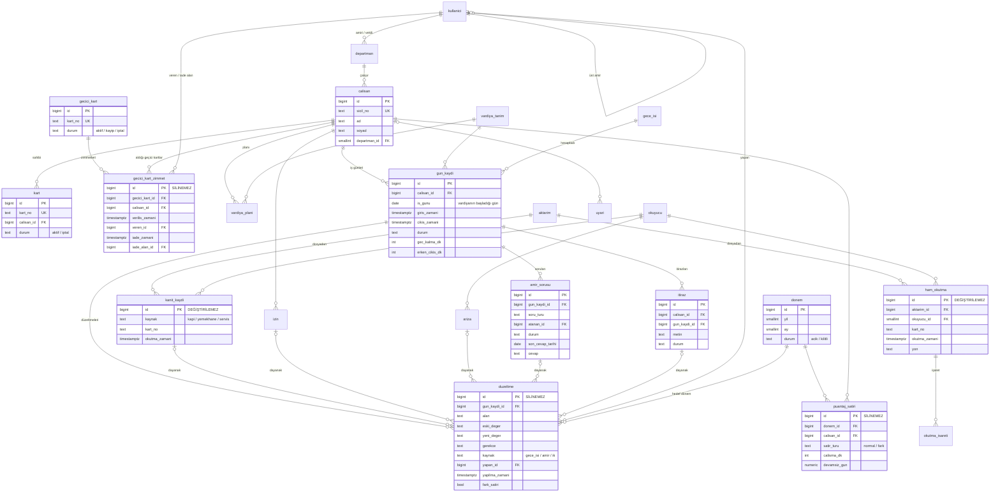

# Veritabanı Tasarımı (Supabase / PostgreSQL)

Veritabanı **Supabase** (bulutta PostgreSQL).
Tüm tablolar `pdks` adlı şemada durur. Supabase'in otomatik REST API'si yalnızca `public` şemasını
açtığı için tablolarımız internete açılmaz. Streamlit uygulaması ve gece işi veritabanına kendi
kullanıcılarıyla doğrudan bağlanır.

## Dosyalar

| Dosya | İçerik |
|---|---|
| `supabase/migrations/20261114000100_tablolar.sql` | Şema ve 24 tablo |
| `supabase/migrations/20261114000200_kurallar.sql` | Trigger'lar, fonksiyonlar, görünümler (silinemezlik, ay kilidi) |
| `supabase/migrations/20261114000300_roller_ve_yetkiler.sql` | `pdks_uygulama` ve `pdks_gece_isi` rolleri, yetkiler |
| `supabase/migrations/20261114000400_varsayilan_ayarlar.sql` | İK ayarlarının varsayılanları, örnek vardiyalar |
| `supabase/migrations/20261115000500_fazla_mesai.sql` | Fazla mesai: yazılı onay, plan, 270 saat / 11 saat sınırları (+2 tablo) |
| `supabase/migrations/20261117010000_kiosk_kaldir.sql` | Kiosk parçalarının kaldırılması (PIN alanları, kiosk fonksiyonları ve görünümü, kiosk ayarları, `pin_kilitlendi` uyarı türü) |
| `supabase/migrations/20261117020000_gecici_kart.sql` | Geçici kart ve zimmet, `guvenlik` rolü, geçici kart uyarıları, `okutma_sahibi()` |
| `supabase/migrations/20261117030000_kart_paylasimi.sql` | Kart paylaşımı şüphe kuralı (`kart_paylasim_kontrol()`) |
| `supabase/tests/kurallar_testi.sql` | 26 kural testi (her şeyi geri alır, iz bırakmaz) |
| `supabase/tests/fazla_mesai_testi.sql` | Fazla mesai kural testleri |
| `supabase/tests/kiosk_kaldirma_testi.sql` | Kiosktan hiçbir parça kalmadığını doğrulayan 9 test |
| `supabase/tests/gecici_kart_ve_paylasim_testi.sql` | Geçici kart ve kart paylaşımı için 34 test |

> **Migration** = veritabanını adım adım kuran, sırayla çalıştırılan SQL dosyası.
> **Trigger** = bir tabloya ekleme/değiştirme/silme yapılırken kendiliğinden çalışan kontrol.

## Temel kurallar ve veritabanı bunu nasıl sağlıyor?

1. **Ham kayda dokunulmaz.** `ham_okutma`, `kanit_kaydi`, `aktarim`, `okutma_isareti` tablolarında
   uygulamanın UPDATE/DELETE yetkisi yok. Yetkisi olan biri (ör. `postgres`) denese bile trigger engeller.
   Mükerrer okutma (sorun 3) silinmez, `okutma_isareti` tablosunda "mukerrer" diye işaretlenir.
2. **Her düzeltme silinemez izle tutulur (sorun 12).** `duzeltme` tablosu: kim (`kaynak`, `yapan_id`),
   ne zaman (`yapilma_zamani`), `eski_deger`, `yeni_deger`, `gerekce` ve dayanağı (kanıt, izin, arıza,
   soru ya da itiraz). Bu tabloda UPDATE, DELETE, TRUNCATE hem yetkiyle hem trigger'la kapalı.
3. **İzsiz değişiklik imkânsız.** `gun_kaydi` tablosunda giriş, çıkış, vardiya ya da "devamsız"
   değişecekse aynı işlemde yazılmış, değeri birebir tutan bir `duzeltme` satırı olmalı. Bunu
   `pdks.duzeltme_uygula(...)` fonksiyonu yapar; doğrudan UPDATE hata verir.
4. **Gece işi yalnızca kanıtla düzeltir.** `kaynak = 'gece_isi'` olan düzeltmede kanıt kaydı ya da izin zorunlu.
5. **Çalışan aleyhine kararı İK verir.** "devamsız" kararı, itirazın reddi ve ayın kilitlenmesi yalnızca
   İK rolüyle olur. Amir "gelmedi" derse soru kapanmaz, `ik_karari_bekliyor` durumuna geçer.
   Sistem en fazla `devamsiz_suphesi` der.
6. **Ay sonu kilidi (sorun 11).** Kilitli ayın kayıtları değişmez ve kilit geri açılamaz. Kilitten sonra
   gelen düzeltme sonraki açık aya `fark_satiri = true` olarak yazılır. Puantaj (`puantaj_satiri`)
   yalnızca kilitli aya yazılır ve sonra değiştirilemez.
7. **Ücret hesaplanmaz.** Puantajda yalnızca gün ve dakikalar var, para alanı yok.
8. **Gizli bilgi yok.** Şifreler açık metin saklanmaz (bcrypt). Veritabanı şifreleri koda değil `.env`'ye.

## Sorun → tablo eşlemesi

| Sorun | Nerede çözülüyor |
|---|---|
| 1 Giriş okutmama | `kanit_kaydi` + `duzeltme`; kanıt vardiya başından sonraysa saat yazılmaz, `amir_sorusu` (`kanit_vardiya_sonrasi`). Yürüme payı: `ayar.yurume_payi_dk` |
| 2 Çıkış okutmama | Kanıttaki çıkış saati yazılır (vardiya sonu değil); yoksa `amir_sorusu` (`cikis_yok`) |
| 3 Mükerrer okutma | `okutma_isareti` (`mukerrer`), eşik `ayar.mukerrer_esik_dk` |
| 4 Kart unutma/kaybetme | Güvenlikten zimmetli **geçici kart**: `gecici_kart`, `gecici_kart_zimmet` (iade edilmemiş kart başkasına verilemez, çalışanda aynı anda tek geçici kart, zimmet silinemez). Okutmanın sahibi `okutma_sahibi()` ile bulunur; amire soru gitmez. Geçici kart yoksa `amir_sorusu.cevap = 'kart_unuttu'`. Uyarılar: `gecici_kart_cakisma`, `gecici_kart_zimmetsiz`, `gecici_kart_iade_edilmedi`, `sik_kart_unutma` (`gecici_kart_kontrol()`). Kayıp kart: `kart.durum = 'iptal'` |
| 5 Okuyucu arızası | `okuyucu`, `ariza` (manuel ya da `otomatik_suphe`), `duzeltme.ariza_id` |
| 7 Gece vardiyası | `gun_kaydi.is_gunu` = vardiyanın başladığı gün; pencere `vardiya_tanim.pencere_once_dk / pencere_sonra_dk` |
| 8 Vardiya değişikliği (basit) | `vardiya_plani` (çalışan + gün), geriye dönükse `ik_onay_durumu` |
| 9 Geç kalma / erken çıkış | `gun_kaydi.gec_kalma_dk / erken_cikis_dk`, `hesap_tamam`; `resmi_tatil`, tolerans ayarları |
| 11 Excel'de düzeltme | Tüm düzeltme sistemde; `donem` kilidi ve fark satırı |
| 12 İz olmaması | `duzeltme` (silinemez), iki ayrı rol |
| 13 Ay sonu yığılması | `amir_sorusu.son_cevap_tarihi`, `eskale_*`, `kullanici.ust_amir_id`, `departman.vekil_amir_id`, `gece_isi` + `v_gece_isi_durumu` |
| 14 İzin/rapor (basit) | `izin`; amir `v_izin_amir` görünümünden yalnızca "izinli" görür |
| 16 Tesis kayıtları (basit) | `aktarim` (aynı dosya iki kez yüklenemez), `kanit_kaydi` |
| 6 Kart paylaşımı | `kart_paylasim_kontrol()`: aynı PDKS okuyucusunda `ayar.kart_paylasim_sn` saniye içinde arka arkaya okutan iki farklı çalışan, ayda `ayar.kart_paylasim_gun` farklı günde tekrar ederse `uyari` (`kart_paylasim_suphesi`). Tek seferlik olay uyarı değil; ceza yok, karar İK'da |
| 10 Fazla mesai | `fazla_mesai_onayi`, `fazla_mesai_plani`, `gun_kaydi.fazla_mesai_dk`, `v_fazla_mesai_yillik` (migration 0500) |
| 15 Bordro aktarımı | `puantaj_satiri`; CSV'yi Python üretir |
| 17 Çalışan kendi kaydını göremiyor | **Kiosk yok.** Çalışan isterse İK, sistemden PDF döküm verir; itirazı (`itiraz`) amir ya da İK girer, reddi yalnızca İK |

## ER diyagramı



Diyagramda okunurluk için yalnızca önemli sütunlar var. `ayar`, `ayar_gecmisi`, `resmi_tatil`,
`gece_isi` ve `uyari` tablolarının tam hali migration dosyasında.

## Fazla mesai (İş Kanunu m.41, m.69; Fazla Çalışma Yönetmeliği)

| Kural | Nerede |
|---|---|
| Her yıl yazılı onay; yoksa fazla mesai planlanamaz | `fazla_mesai_onayi` (yalnızca İK girer, silinemez), `fm_onay_gecerli_mi()` |
| Onay geri alınır, bildirimden 30 gün sonra geçersiz olur | `geri_alma_bildirim_tarihi` → `gecerlilik_bitisi`; sonraki planlar kendiliğinden `iptal`, `uyari` (`fm_onay_geri_alindi`) |
| Önceden plan: amir talep eder, İK onaylar/reddeder | `fazla_mesai_plani` (`talep → onaylandi / reddedildi / iptal`), silinemez |
| Günlük toplam ≤ 11 saat | vardiya süresi + `planli_dk` ≤ `ayar.gunluk_azami_calisma_dk` |
| Yılda ≤ 270 saat (takvim yılı) | onaylı planlar toplamı ≤ `ayar.fm_yillik_sinir_dk`; %80'de `uyari` (`fm_yillik_sinir_yaklasti`) |
| Gece vardiyasına fazla mesai yok (m.69) | gece yarısını aşan vardiyaya plan girilemez |
| Puantaja yalnızca onaylı plan kadarı girer | `gun_kaydi.fazla_mesai_dk` ≤ onaylı `planli_dk` (trigger), `puantaj_satiri.fazla_mesai_dk`, `v_puantaj_canli` |

Sınırlar **onay anında** veritabanında kontrol edilir; ekran atlansa bile delinemez.
Fazla mesai burada basitçe "planlı vardiya bitişinden sonra çalışılan süre"dir (haftalık 45 saat hesabı kapsam dışı).
Ücret yok, yalnızca dakika. Plansız ya da planı aşan çalışmayı gece işi puantaja yazmaz;
İK'ya `fm_plansiz_calisma`, `fm_onay_yok` veya `fm_gunluk_sinir_asildi` uyarısı yazar (eşik: `ayar.fm_plansiz_esik_dk`).
İK ekranı için `v_fazla_mesai_yillik` görünümü çalışan başına onaylı, gerçekleşen ve kalan dakikayı verir.

## Gece işi akışı (veritabanı açısından)

1. Dosyaları `aktarim` + `ham_okutma` / `kanit_kaydi` tablolarına yükle (aynı dosya ikinci kez reddedilir).
2. Mükerrer, iptal kart, bilinmeyen kart okutmalarını `okutma_isareti` ile işaretle.
3. Her çalışan için vardiya penceresine göre `gun_kaydi` oluştur (saatler yalnızca PDKS'den).
4. Eksikleri kanıtla düzelt: `select pdks.duzeltme_uygula(...)`. Kanıt vardiya başından sonraysa düzeltme yapma, `amir_sorusu` aç.
5. Süresi geçen soruları `eskale` et, uyarıları yaz, `gece_isi` satırını `basarili` yap.

Örnek düzeltme (Python'da parametreli sorgu, `psycopg`):

```python
cur.execute(
    "select pdks.duzeltme_uygula(%s, 'giris_zamani', %s, %s, 'gece_isi', p_kanit_kaydi_id => %s)",
    (gun_kaydi_id, "2026-11-13 08:00+03", "Kapı kaydı 07:50, vardiya öncesi", kanit_id),
)
```

## Kurulum (Supabase)

1. supabase.com'da proje aç.
2. **SQL Editor**'de `supabase/migrations` altındaki 4 dosyayı sırayla çalıştır
   (ya da Supabase CLI ile: `supabase link` → `supabase db push`).
3. Rollere şifre ver (şifreyi kimseyle paylaşma, repoya yazma):
   ```sql
   alter role pdks_uygulama with login password 'GÜÇLÜ_BİR_ŞİFRE';
   alter role pdks_gece_isi with login password 'BAŞKA_GÜÇLÜ_ŞİFRE';
   ```
4. Bağlantı bilgisini **Project Settings → Database → Connection string** kısmından al.
   Pooler kullanılıyorsa kullanıcı adı `pdks_uygulama.<proje-kodu>` biçimindedir.
5. `.env.example` dosyasını `.env` olarak kopyalayıp bilgileri doldur. `.env` zaten `.gitignore`'da.
6. Testleri çalıştır: `psql "$PDKS_ADMIN_DB_URL" -v ON_ERROR_STOP=1 -f supabase/tests/<dosya>.sql` (her test dosyası için)
   Sonda `TÜM TESTLER GEÇTİ` görmelisin.

## Bilinçli tercihler

- Değerler için enum yerine `text + check` kullandık: okunması ve yeni değer eklemesi daha kolay.
- `vardiya_plani` ve `izin` değiştirilebilir; bunların etkisi `gun_kaydi`'na yine `duzeltme` üzerinden yansır.
- Uygulama girişi (amir/İK) karar bekliyor. Öneri: `kullanici` tablosunda bcrypt ile şifre. Supabase Auth kullanılmıyor.
- **Kiosk yok.** Kiosk için eklenen parçalar `20261117010000_kiosk_kaldir.sql` ile kaldırıldı. `ayar_gecmisi`'ndeki eski kiosk ayarı kayıtları silinemez iz olduğu için yerinde durur.
- Fark satırındaki dakika farkını hesaplamak ve puantajı yazmak Python'un işi; veritabanı yalnızca kuralları korur.
